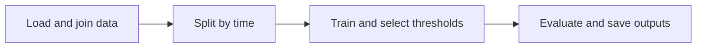

# Machine Learning Fraud Detection

A Python pipeline for detecting fraud in online payments. It prepares transaction
data, compares Logistic Regression, Random Forest, and XGBoost, and saves trained
models, predictions, and evaluation reports.



## Dataset

[IEEE-CIS Fraud Detection](https://www.kaggle.com/competitions/ieee-fraud-detection/overview)
contains anonymized e-commerce transactions supplied by Vesta. The labeled file
has 590,540 transactions, including 20,663 fraudulent payments (about 3.5%).
See the [data description and downloads](https://www.kaggle.com/competitions/ieee-fraud-detection/data).
Kaggle requires sign-in and acceptance of the competition rules.

Keep the original filenames under `data/ieee-fraud-detection/`:

```text
train_transaction.csv
train_identity.csv
```

The loader reads CSV or Parquet and joins only `DeviceType` from the matching
identity file using `TransactionID`. Transactions without an identity match stay
in the data with a missing device category. The identity file is optional.
Raw datasets and generated artifacts are excluded from Git.

## Setup

Use Python 3.12 and run these commands from the project folder:

```powershell
python -m venv .venv
.\.venv\Scripts\Activate.ps1
python -m pip install -r requirements.txt
```

## Run

```powershell
python -m fraud_detection
```

Each run replaces the three saved models, held-out prediction CSVs, and
`report.json` in `artifacts/`.

- `logistic_regression.joblib`, `random_forest.joblib`, `xgboost.joblib`: trained pipelines and thresholds.
- `<model>_test_predictions.csv`: test transactions, fraud scores, flags, and outcomes.
- `report.json`: validation, test, and full-dataset results.

## Model inputs

All three models use **392 transaction predictors plus `DeviceType`: 393 source
inputs before encoding**.

| Columns | Use |
| --- | --- |
| `TransactionAmt` | `log1p(amount)` reduces the range between small and large payments. |
| `TransactionDT` | Numeric time input and the key for chronological splitting. |
| `C1`–`C14`, `D1`–`D15`, `V1`–`V339` | Provided numeric features with anonymized definitions. |
| `dist1`, `dist2` | Provided numeric distance features. |
| `ProductCD` | Product category. |
| `card1`–`card6` | Categorical card attributes, including encoded fields. |
| `addr1`, `addr2` | Categorical address codes. |
| `P_emaildomain`, `R_emaildomain` | Purchaser and recipient email domains. |
| `M1`–`M9` | Categorical match indicators. |
| `DeviceType` | Device category from the identity file. |

`isFraud` supplies the training and evaluation labels: 1 means fraud, 0 means
legitimate. `TransactionID` is used for joining and identifying predictions.
Neither is a predictor. Other identity fields, including `DeviceInfo`, are excluded.

Preprocessing is fitted on training rows only:

- Logistic Regression scales numeric inputs. It and Random Forest one-hot encode categories.
- For D, distance, and V fields, those two models learn median replacements and add missing-value flags.
- XGBoost handles numeric blanks directly and uses native categorical splits with category codes learned from training data.
- Missing categories become `missing`; unseen categories are handled by the fitted encoders.

Logistic Regression uses `lbfgs` with up to 5,000 optimizer iterations. Random
Forest uses 200 trees, maximum depth 30, and at least 5 samples per leaf. XGBoost
uses 300 trees, maximum depth 6, and learning rate 0.05. Both tree models use two
CPU workers. Class weighting accounts for fraud's rarity using training labels.

## Evaluation

By default, the earliest 70% of distinct `TransactionDT` values are used for
training, the next 15% for validation, and the final 15% for testing.
Equal time values stay together; these percentages refer to distinct time
values, so the percentages of transaction rows can differ.

Validation chooses each model's threshold with the highest F1. That threshold
stays fixed for test and full-dataset evaluation. The preferred model is selected
by validation F1.

Each model in `report.json` has:

- `validation`: results used to choose the threshold.
- `test_data_only`: results on the held-out test partition.
- `full_run`: results across the entire input file, including training rows.

Use `test_data_only` to assess performance on unseen records. `full_run` uses
the same trained model and threshold; it includes rows the model learned from.
Kaggle's separate test files have no fraud labels, so local evaluation uses the
held-out part of the labeled training file.

Predicting every payment as legitimate would achieve about 96.5% accuracy while
catching no fraud. Precision, recall, F1, and ranking metrics reveal that failure.

## Results

Measured results with **393 source inputs and seed 42**, from
`artifacts/report.json`. Each threshold was selected using validation data and
kept fixed for both tables. Repeated experiments have consulted the same test
split, so these results are exploratory.

**Held-out test results: 88,081 transactions.**

| Model | Precision | Recall | F1 | ROC-AUC |
| --- | --- | --- | --- | --- |
| Logistic Regression | 0.2783 | 0.4398 | 0.3409 | 0.8381 |
| Random Forest | 0.4852 | 0.4372 | 0.4599 | **0.8783** |
| XGBoost | **0.5210** | **0.4532** | **0.4847** | 0.8769 |

XGBoost has the highest test F1. Random Forest has the highest test ROC-AUC.

**Full-dataset counts, including training rows.** Use the first table to judge
performance on unseen transactions. Thresholds are rounded to six decimal places.

| Model | Selected threshold | Total transactions | True positives | False positives | False negatives |
| --- | --- | --- | --- | --- | --- |
| Logistic Regression | 0.899268 | 590,540 | 9,900 | 9,541 | 10,763 |
| Random Forest | 0.625305 | 590,540 | 12,396 | 7,780 | 8,267 |
| XGBoost | 0.776490 | 590,540 | 14,436 | 6,033 | 6,227 |

True positives are fraud caught; false positives are legitimate transactions
flagged; false negatives are fraud missed.

The four metrics below range from 0 to 1; higher is better:

- **Precision:** The fraction of flagged transactions that were actually
  fraudulent. Higher precision means fewer false alarms among the flags.
- **Recall:** The fraction of actual fraudulent transactions that the model
  caught. Higher recall means less missed fraud.
- **F1:** Combines precision and recall using their harmonic mean:
  `2 * precision * recall / (precision + recall)`. A high F1 requires both to be strong.
- **ROC-AUC:** Area under the curve comparing recall with the false-positive
  rate (the fraction of legitimate transactions incorrectly flagged) across
  thresholds. It summarizes how well fraud scores separate fraudulent and
  legitimate transactions: **0.5** means random ranking and **1.0** means
  perfect separation.

**Selected threshold:** The minimum fraud score needed to flag a transaction.
It is chosen to maximize F1 on validation data, then kept fixed for testing.
A higher threshold generally produces fewer fraud flags.
